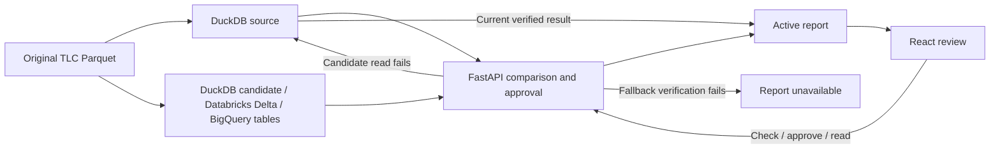

# Cutover Lab

A migration rehearsal for a daily finance report, using real [NYC TLC yellow taxi trip records](https://www.nyc.gov/site/tlc/about/tlc-trip-record-data.page). The company, reporting faults and cutover are simulated. The app compares recorded CBD congestion fees and pickup counts before a person can switch the active report to Databricks SQL, BigQuery, or a local DuckDB candidate.

On January 6, both reports show **80,126 trips and $38,831.25**. A candidate revision gives Midtown Center **$813.00 too little** and Midtown East **$813.00 too much**. The zone check blocks the switch even though the month and day reconcile.

## Run locally

Use Python 3.11–3.14, [uv](https://docs.astral.sh/uv/getting-started/installation/), and Node 22.12+ with npm. From the checkout root:

```sh
uv sync --locked
(cd frontend && npm ci && npm run build)
uv run --locked python -m uvicorn migration_rehearsal.api:app --host 127.0.0.1 --port 8000
```

Open [the local review](http://127.0.0.1:8000). The built React app and API share the same origin. The default fixture is deterministic and small. Its amounts differ from the full dataset. On the initial **Midtown fee swap** scenario, click **Run checks**, choose **Corrected report**, run checks again, click **Switch to cloud**, then **Simulate failure**. The local target uses a second, isolated DuckDB connection.

For real TLC inputs, stop the fixture server and run:

```sh
uv run --locked python -m migration_rehearsal download
uv run --locked python -m scripts.audit_inputs
REHEARSAL_DATA=full uv run --locked python -m uvicorn migration_rehearsal.api:app --host 127.0.0.1 --port 8000
```

The downloader verifies each SHA-256 against [the input manifest](data/manifest.json). It stops on a mismatch. To adopt a published revision, update the manifest only after recording the old and new hashes and recalculating the independent baseline. Raw files, .env, local media and builds are ignored by Git.

## Live warehouse setup

Start with the full inputs and install cloud dependencies.

```sh
uv sync --locked --extra cloud
test -f .env || cp .env.example .env
```

**Databricks Free Edition.** Sign in, open **SQL Warehouses**, and find the starter warehouse and its **Connection details**. Set `DATABRICKS_SERVER_HOSTNAME` to the hostname without a protocol and `DATABRICKS_HTTP_PATH` to the path shown. Keep the dedicated schema or supply one you control. Use browser-based OAuth U2M when prompted. On an OS-managed network where Python rejects the certificate chain, `REHEARSAL_SYSTEM_TRUST=1` uses the OS trust store with verification enabled.

```sh
uv run --locked --extra cloud python -m migration_rehearsal smoke databricks
uv run --locked --extra cloud python -m migration_rehearsal prepare databricks
uv run --locked --extra cloud python -m scripts.verify --target databricks --output evidence/databricks
```

Preparation uploads each verified original file into a dedicated Unity Catalog volume and creates a separate managed Delta table. Report queries pin Delta version 0, the CTAS snapshot. If using the workspace’s **Create table from file** UI, use the same names from the prepare command and confirm the first complete table version with `DESCRIBE HISTORY`. Set the version overrides in `.env` if the import created a later snapshot. Warehouse quotas can delay a cold start or stop compute. Retry the smoke check after the warehouse is running. [Databricks Free Edition](https://docs.databricks.com/aws/en/getting-started/free-edition-limitations) · [SQL connector and OAuth](https://docs.databricks.com/aws/en/dev-tools/python-sql-connector) · [File upload](https://docs.databricks.com/aws/en/ingestion/create-or-modify-table)

**BigQuery Sandbox.** Open a Google Cloud project with billing disabled and the BigQuery API available. Set `BIGQUERY_PROJECT` and, if needed, `BIGQUERY_DATASET` and `BIGQUERY_LOCATION`. Use the [Google Cloud CLI](https://docs.cloud.google.com/sdk/docs/install-sdk) to authorize the Python client.

```sh
gcloud auth application-default login --disable-quota-project
uv run --locked --extra cloud python -m migration_rehearsal smoke bigquery
uv run --locked --extra cloud python -m migration_rehearsal prepare bigquery
uv run --locked --extra cloud python -m scripts.verify --target bigquery --output evidence/bigquery
```

Preparation checks that billing is disabled, then batch-loads each original Parquet into its own table. It uses no streaming or DML. Sandbox tables expire after 60 days. Run prepare again if they have expired. Reuse of an existing named table still requires a passing comparison. The sandbox project must let the local account read billing status, create datasets and load/query data. [BigQuery Sandbox](https://docs.cloud.google.com/bigquery/docs/sandbox) · [Batch loads](https://docs.cloud.google.com/bigquery/docs/batch-loading-data) · [Application authentication](https://docs.cloud.google.com/bigquery/docs/authentication/getting-started)

Run the browser against either live target:

```sh
REHEARSAL_DATA=full uv run --locked --extra cloud python -m uvicorn migration_rehearsal.api:app --host 127.0.0.1 --port 8000
```

Choose **Databricks SQL** or **BigQuery** under **Target**. For the clean scenario, **Switch to cloud** issues a fresh read through the selected adapter before showing a switch. **Refresh active report** issues another read on that adapter. **Simulate failure** exercises the source read and verifies the returned batch. Use the **Failure test** selector to exercise a stale or unavailable source.

## Architecture



- [Input and SQL contract](docs/data-contract.md) describes civil-time mapping, signed cents, coverage, and evidence limits.
- [Evidence index](evidence/README.md) links measured results. [Demo guide](docs/demo.md) describes screenshots, recordings and voiceover.
- [Finance one-pager](docs/finance-brief.md), [owner study guide](docs/study-guide.md) and [rename procedure](docs/rename.md).

## Verify

```sh
uv run --locked python -m pytest -q
uv run --locked python -m scripts.verify --mode fixture
uv run --locked python -m scripts.verify --target local --output evidence/local
(cd frontend && npm ci && npm run build && npx playwright install chromium && npm run test:browser)
```

For browser verification against a running full-data server with both live connections configured:

```sh
cd frontend
REHEARSAL_URL=http://127.0.0.1:8000 REHEARSAL_BROWSER_DATA=full \
  REHEARSAL_BROWSER_CLOUDS=databricks,bigquery REHEARSAL_SCREENSHOTS=../media/screenshots \
  npm run test:browser
```

One local server process owns the rehearsal state and serializes mutations. Use one Uvicorn worker. Restarting the process starts a new rehearsal. Run on loopback so the controls and private warehouse credentials stay on the local machine.
